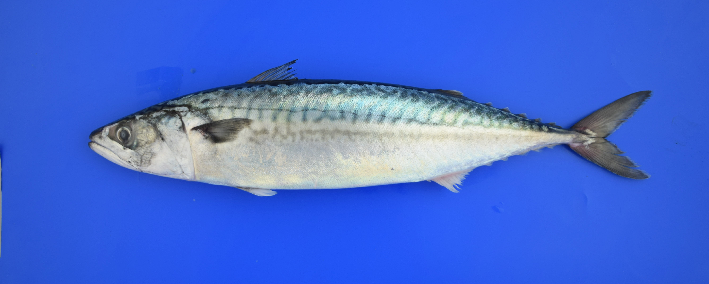

---
output:
  word_document:
    reference_docx: ../report_template_v1.9.dotx
---


```{r setup, include=FALSE}

# ==========================================================================================================
# Generate WQ mackerel sampling overview
# 
# 28/05/2024 first coding
# 08/01/2026 adapted for 2025 sampling
# ==========================================================================================================

knitr::opts_chunk$set(echo = FALSE,	message = FALSE,	warning = FALSE,	comment = "",	crop = TRUE )
knitr::opts_chunk$set(fig.width=10) 

options(dplyr.summarise.inform = FALSE)

# Reset lists
rm(list=ls())

# Libraries
library(rmarkdown)                   # note: requires knitr 1.21

require(tidyverse, quietly=TRUE)     # combined package of dplyr, tidyr, ggplot, readr, purrr and tibble
require(lubridate, quietly=TRUE)     # data handling
require(reshape2, quietly=TRUE)      # reshaping data; e.g. cast
require(RColorBrewer)                # colour schemes
library(viridis)
library(pander)
library(cowplot)
library(patchwork)                   # composer of plots

library(captioner)                   # for captions
tab_nums <- captioner::captioner(prefix = "Table " , levels=1, type=c("n"), infix=".")
fig_nums <- captioner::captioner(prefix = "Figure ", levels=1, type=c("n"), infix=".")

# Source all the utils
source("../../flyshoot/R/FLYSHOOT utils.r")

spatialdir <- "C:/Users/MartinPastoors/OneDrive - Martin Pastoors/DATA/RDATA"

# spatial data files

load(file.path(spatialdir, "world_mr_sf.RData"))
load(file.path(spatialdir, "world_mr_df.RData"))
load(file.path(spatialdir, "rect_lr_sf.RData"))
load(file.path(spatialdir, "fao_df.RData"))

load(file.path(spatialdir, "world_lr_df.RData"))

load(file.path(spatialdir, "asfis.RData"))

# ===============================================================================
#  Load data
# ===============================================================================

# set onedrive directory
onedrive <- file.path(get_onedrive(team="Martin Pastoors", site="WQ - General"), "2025")

df <-
  readxl::read_excel(
    path  = file.path(onedrive, "makreel","Makreel paaionderzoek 2025.xlsx"),
    sheet = "Haul" 
  ) %>% 
  lowcase() %>% 
  drop_na(date) %>% 
  rename(lon=plotlon, lat=plotlat) %>% 
  mutate(
    year  = lubridate::year(date),
    month = lubridate::month(date),
    week  = lubridate::week(date),
    yday  = lubridate::yday(date),
    mackerelcaught = ifelse(!is.na(picture1), TRUE, FALSE)
  )

# calculate the scaling of plots

lon_range <- range(df$lon, na.rm = TRUE)
lat_range <- range(df$lat, na.rm = TRUE)

# Add 10% buffer on each side
lon_buffer <- diff(lon_range) * 0.1
lat_buffer <- diff(lat_range) * 0.1

xmin <- floor(lon_range[1] - lon_buffer)
xmax <- ceiling(lon_range[2] + lon_buffer)
ymin <- floor((lat_range[1] - lat_buffer) * 2) / 2
ymax <- ceiling((lat_range[2] + lat_buffer) * 2) / 2

# Calculate actual distances
xdistance <- icosa::arcdist(p1 = c(xmin, ymin), p2 = c(xmax, ymin))
ydistance <- icosa::arcdist(p1 = c(xmin, ymin), p2 = c(xmin, ymax))
data_aspect <- ydistance / xdistance

xlim <- c(xmin, xmax); ylim <- c(ymin, ymax)

```


**WQ 2025 research to assess spawning of mackerel in the North Sea**

```{r, echo=FALSE, out.width = "100%", fig.align="center", message=FALSE, warning=FALSE, cache=FALSE}
  

```

<br><br>

<div style="float: left; width: 60%;">

**Prepared by:** Martin Pastoors & Ewout Blom

**Organizations:** MPFF & WMR  

**Project:** WQ MAC 2025 (project 2025009)

**Date:** `r format(Sys.time(), '%d %B %Y')`

</div>

<br><br>

<br><br>

<br><br>

<br><br>

<br><br>

<br><br>

<br><br>

```{r, echo=FALSE, fig.height=2.5, fig.align="left", message=FALSE, warning=FALSE, cache=FALSE}

p1 <- cowplot::ggdraw() +
      cowplot::draw_image("../MPFF logo with text.png", 
                         x = 0.0, y = 0, 
                         width = 0.9, height = 1, 
                         hjust = 0.0, vjust = 0)  # Bottom-aligned, full height

p2 <- cowplot::ggdraw() +
      cowplot::draw_image("../Wageningen University and Research2.png", 
                         x = 0.0, y = 0, 
                         width = 0.9, height = 0.5,  # Half height
                         hjust = 0.0, vjust = 0)  # Bottom-aligned

patchwork::wrap_plots(p1, p2, widths = c(1, 2.5))

# p1 <- cowplot::ggdraw() +
#             cowplot::draw_image("../MPFF logo with text.png") # 332 x 399
# p2 <- cowplot::ggdraw() +
#             cowplot::draw_image("../Wageningen University and Research2.png") # 455 x 110
# 
# patchwork::wrap_plots(p1, p2, widths = c(0.5, 2.5))

# print(patchwork::wrap_plots(p1 + theme(plot.margin = unit(c(0,30,0,0), "pt")),
#                             p2 + theme(plot.margin = unit(c(0,0,0,30), "pt"))) +
#         patchwork::plot_layout(widths=unit(c(150,400), "pt"))) 

```


# Introduction

In 2023, ICES reviewed available information on mackerel stock structure and concluded that Northeast Atlantic mackerel is one stock with no separate spawning components. This means that the next triennial mackerel and horse mackerel egg survey in 2025 will no longer focus on the previous components (North Sea, western, southern). Therefore, it is now extra important to get accurate information on mackerel reproduction in the North Sea so that they can eventually be fully included in the egg survey. 

Catches of mackerel in demersal (flyshoot) fisheries in the North Sea could be used to assess spawning maturity of mackerel in the southern North Sea. In 2024, we carried out an exploratory study of spawning maturity of mackerel in the southern North Sea and concluded that spawning mackerel were caught and that the maturity stage could be determined from pictures taken by fishers. 

Now that the Mackerel and Horse Mackerel Egg Survey will take place during 2025, the demersal fishery would like to contribute by collecting and supplying samples of spawning mackerel during the mackerel spawning season (May-July) in the North Sea.The aim was to sample only mackerel that are in a state just before spawning (i.e. with hydrated eggs). 

Here, we are reporting on an the sampling of mackerel in demersal fisheries to contribute to the assessment the spawning status of mackerel in the southern North Sea and Eastern Channel. Therefore, we have asked demersal skippers to record, measure and take pictures of a limited number of mackerel from their catches. 

# Methods

The main aim of the mackerel research program 2025 is to collect samples of spawning mackerel in the southern or central North Sea during the spawning season (May-July 2025) and to deliver those samples to Wageningen Marine Research (WMR) for inclusion in the WGMEGGS sampling protocol. 

The Mackerel and Horse Mackerel Egg Survey in the Southern North Sea will be carried out by R/V Endeavour (UK), while the analyses of the samples will be carried out by DTU Aqua (DK). Wageningen Marine Research will be the local contact point for the samples collected by the Dutch flyshoot vessels and convert the samples from frozen state to conservation in formalin. 

Participating skippers were asked to take samples of spawning female mackerel. Each spawning female mackerel was photographed and measured on a standardized measuring board that was supplied to the participating vessels. In coordination with WMR, the photographs were reviewed for spawning stage. If the sampled female mackerel was deemed to be in actual spawning condition [“glazen eitjes zichtbaar”], the skippers were be asked to remove the gonads and to freeze the fish and gonads separately using standardized plastic bags, noting the vessel, date, haul, time and location. If samples had been frozen during a trip, the skipper notified Martin Pastoors (MPFF) who arranged for a temporary storage or a pickup of the samples. At all times, the samples were  kept frozen. 
 
Due to logistical reasons and because of the short fishing season in the southern North Sea, samples of mackerel were only collected on the SCH99.  

# Results 

**Sampling overview**

The sampling for mackerel was carried out in June 2025. 

```{r echo=FALSE, fig.align="center", fig.asp=1.2, message=FALSE, warning=FALSE}

tab_nums(
  name    = "sampling1", 
  level = 1, display = FALSE,
  caption = "Mackerel sampling overview 2025")

t <-
  df %>%
  group_by(year, month, week, mackerelcaught) %>% 
  summarise(
    nvessels  = n_distinct(vessel),
    ntrips    = n_distinct(vessel, year, month, week),
    nsamples  = sum(!is.na(picture1))
  ) %>% 
  tidyr::pivot_longer(names_to = "variable", values_to = "data", nvessels:nsamples) %>% 
  mutate(variable = factor(variable, levels=c("nvessels", "ntrips","nsamples"))) 

t %>% 
  filter(mackerelcaught) %>% 
  reshape2::dcast(month+week ~ variable, sum, value.var = "data",  margins=c("month")) %>% 
  pander::pandoc.table(.,
               style = "simple",
               split.tables=400, 
               missing=".",
               round=c(0,0,0,0,0,0,0,0,0,0,0,0,0,0,0,0,0,0,0,0,0))


```
_`r tab_nums("sampling1")`_


**Sex of the sampled mackerel**

```{r echo=FALSE, fig.align="center", fig.asp=1.2, message=FALSE, warning=FALSE}

tab_nums(
  name    = "char1", 
  level = 1, display = FALSE,
  caption = "Characteristics of the sampled mackerel")

df %>%
  filter(mackerelcaught) %>% 
  group_by(year, month, week) %>% 
  summarise(
    nfemales      = sum(sex == "F"),
    nspawning     = sum(paaiend == "Y"),
    meanlength    = mean(length, na.rm=TRUE)
  ) %>% 
  pander::pandoc.table(.,
               style = "simple",
               split.tables=400, 
               missing=".",
               round=c(0,0,0,0,0,1,1,0,0,0,0,0,0,0,0,0,0,0,0,0,0))

```


_`r tab_nums("char1")`_

\newpage

**Spatial overview of sampling and mackerel caught (by week)**

```{r echo=FALSE, fig.align="center", fig.asp=0.6, message=FALSE, warning=FALSE}


fig_nums(
  name    = "sampling1", 
  level = 1, display = FALSE,
  caption = "Number of mackerel in spawning condition, by week.")
  
ggplot() +

  theme_publication() +
  theme(
    text             = element_text(size=12),
    plot.margin      = unit(c(0,0,0,0), "cm"),
    legend.position  = "right",
    legend.direction = "vertical"
  ) +

  coord_quickmap(xlim=xlim , ylim=ylim) +

  geom_polygon(data=world_mr_df, aes(x=long, y=lat, group=group), fill = "grey75") +
  geom_polygon(data=fao_df,   aes(long, lat, group=group), fill = NA, size=0.25, color="black") +

  # geom_point(data=slice(tt, c(1,nrow(tt))),
  #           aes(x=lon, y=lat),
  #           colour="red", size=5) +

  # geom_point(data=filter(df, !mackerelcaught), 
  #            aes(x=lon, y=lat),
  #             alpha = 0.5, shape=3) +
  # geom_point(data=filter(df, mackerelcaught, !grepl("Y", paaiend)), 
  #            aes(x=lon, y=lat),
  #            alpha = 0.5, colour="black") +
  geom_jitter(data=filter(df, mackerelcaught, grepl("Y", paaiend)), 
             aes(x=lon, y=lat),
             alpha = 0.5, colour="red", width=0.1, height=0.05) +

  labs(x = NULL, y = NULL, colour="",
       title=paste("Mackerel spawning samples per week")) +
  guides(size = guide_legend(nrow = 1)) + 
  facet_wrap(~week, ncol=3)

```

_`r fig_nums("sampling1")`_


# Discussion

The main aim of the mackerel research program 2025 was to collect samples of spawning mackerel in the southern or central North Sea during the spawning season (May-July 2025) and to deliver those samples to Wageningen Marine Research (WMR) for inclusion in the WGMEGGS sampling protocol. Unfortunately, due to logistical reasons and because of the short fishing season in the southern North Sea, samples of mackerel were only collected on the SCH99. However, the fish that were collected, were in the right spawning stage and could be used for subsequent analysis.   

Participating skippers took samples of spawning female mackerel and each spawning female mackerel was photographed and measured on a standardized measuring board that was supplied. WMR made initial assessment on the spawning stage from the photographs and they were all found to be in spawning state. Subsequently, the skippers removed the gonads and froze the fish and gonads separately using standardized plastic bags. At all times, the samples were  kept frozen. 

The spawning mackerel were found in the southern North Sea between 51 and 54 degrees latitude and between 1 and 4 degrees longitude (east). Surprisingly, spawning activity was also demonstrated in the Eastern English Channel during week 26, which has not been observed before. 

\newpage

# Annex 1: overview of samples 

```{r echo=FALSE, fig.align="center", fig.asp=1.2, message=FALSE, warning=FALSE}

df %>%
  dplyr::select(vessel, time, lon, lat, rect, area, year, week, sample, sex, paaiend, length) %>% 
  pander::pandoc.table(.,
               style = "simple",
               split.tables=400, 
               missing=".",
               round=c(0,0,2,2,0,0,0,0,0,0,0,1,1,0,0,0,0,0,0,0,0))


```

\newpage

# Annex 2: individual samples of mackerel with location, date and status. 

```{r echo=FALSE, fig.align="center", fig.asp=0.4, message=FALSE, warning=FALSE}

tmp <- data.frame(stringsAsFactors = FALSE)

# w <- 23

for (w in unique(df$week)) {

  # now picture 1
  t <-
    df %>% 
    filter(week == w) %>% 
    filter(!is.na(picture1))

  if (nrow(t)>0) {
    
    # n <- 1
    
    for (n in 1:nrow(t)) {
    
      # map
      p0 <- 
        ggplot() +
        theme_publication() +
        theme(
          text             = element_text(size=12),
          plot.margin      = unit(c(0.2,0.2,0.2,0.2), "cm"),
          legend.position  = "right",
          legend.direction = "vertical"
        ) +
        coord_quickmap(xlim=xlim , ylim=ylim) +
        geom_polygon(data=world_mr_df, aes(x=long, y=lat, group=group), 
                     fill = "grey85", colour="grey25") +
      
        geom_point(data=t[n,], 
                   aes(x=lon, y=lat),
                   size=2) +
        labs(x = NULL, y = NULL)
      
      # ggsave("tempfig.png", p0, width = 3, height = 5, dpi = 72)
      # pl     <- magick::image_read("tempfig.png")
      # p0 <- cowplot::ggdraw() + cowplot::draw_image(pl) 
      
      # picture1
      pl     <- magick::image_read(file.path(onedrive, "makreel", "pictures", t$picture1[n]))
      if (magick::image_info(pl)$height > magick::image_info(pl)$width) 
        pl <- magick::image_rotate(pl, 90)
      
      p1 <- cowplot::ggdraw() + cowplot::draw_image(pl) 
      
      if (!is.na(t$picture3[n])) {
        pl     <- magick::image_read(file.path(onedrive, "makreel", "pictures", t$picture3[n]))
        if (magick::image_info(pl)$height > magick::image_info(pl)$width) 
          pl <- magick::image_rotate(pl, 90)
          p2 <- cowplot::ggdraw() + cowplot::draw_image(pl) 
      
        print(patchwork::wrap_plots(p0,p1,p2, ncol = 3) +
                patchwork::plot_layout(width=c(1, 2.5, 2.5)) +
                patchwork::plot_annotation(title=paste0("Sample:", t[n,]$sample,", ",
                                                        format(t[n,]$date, "%d/%m/%Y"),
                                                        ", Sex:", t[n,]$sex,
                                                        ", Length:", t[n,]$length, 
                                                        ", Spawning:", t[n,]$paaiend)) )
        
      } else {
        print(patchwork::wrap_plots(p0, p1, ncol = 3) +
                patchwork::plot_layout(width=c(1, 2.5)) +
                patchwork::plot_annotation(title=paste0("Sample:", t[n,]$sample,", ",
                                                        format(t[n,]$date, "%d/%m/%Y"),
                                                        ", Sex:", t[n,]$sex,
                                                        ", Length:", t[n,]$length, 
                                                        ", Spawning:", t[n,]$paaiend)) )
        
      }
    } # end of n
  } # end of t
} # end of w


```


